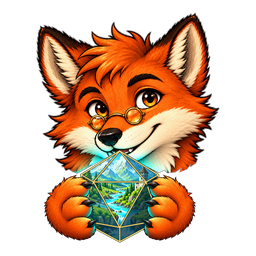
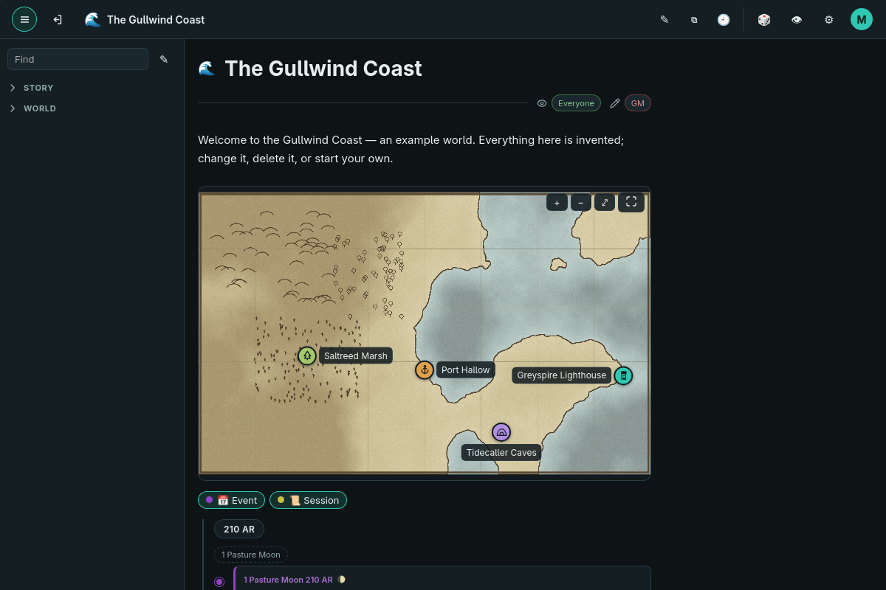
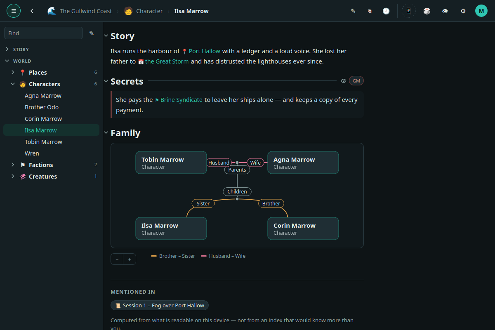
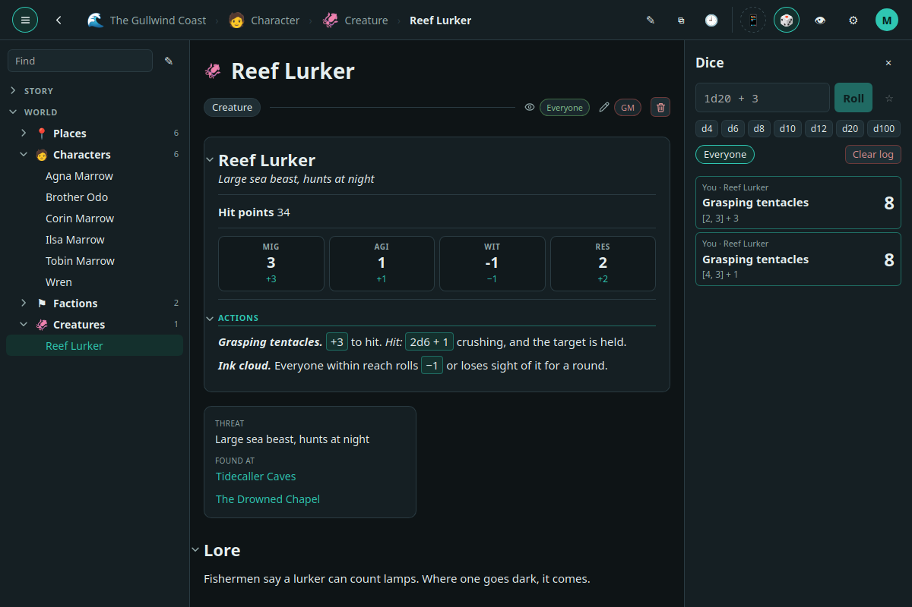
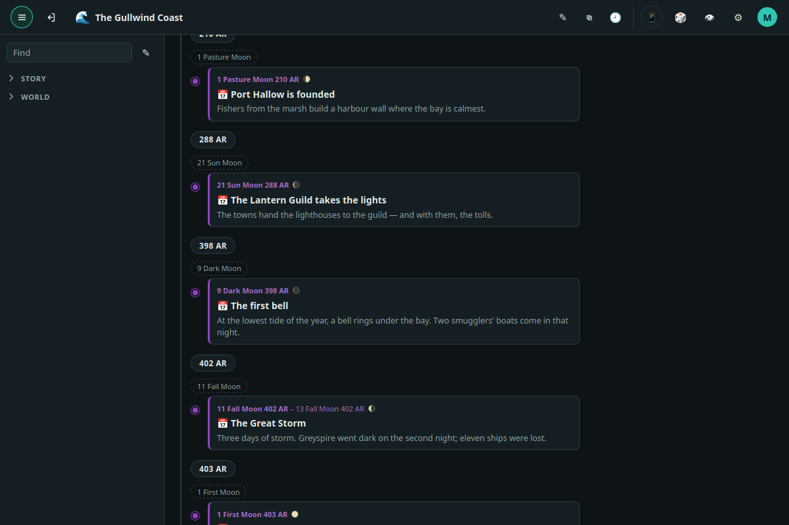
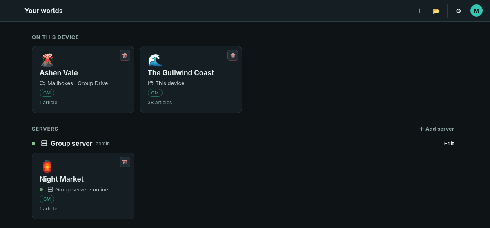
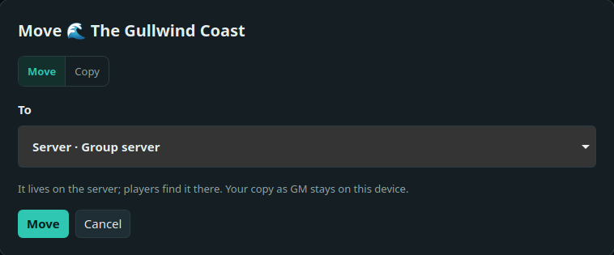

<h1 align="center">AnotherWorldbuilder</h1>

The wiki for your worlds and campaigns in tabletop role-playing games – on your computer, with your data, together with your group.

<a href="../../releases/latest"><b>Download</b></a> · <a href="#try-the-example-world">Example world</a> · <a href="source/docs/server-setup.md">Run a server</a> · <a href="source/docs/README.md">Documentation</a> · <a href="source/README.md">Build it yourself</a>

> **In development.** Not meant for real use yet: formats may change,
> and older worlds are not carried over when they do. Worlds of 0.1 come over
> as a package (*Options → Transfer*).

## What it does

- **A wiki for the world:** articles with types and properties you define yourself –
  character, place, faction, creature, session. Links between them, an infobox, a
  side bar outline, search. Templates give you a start.
- **Maps** to pan and zoom, with pins that lead to the article, regions, and layers
  that switch to the next map (the tower, its cellar).
- **Calendar and timeline** in your world's own calendar – months, weekdays, eras and
  moons – plus family trees.
- **Stat blocks and dice:** rolls you click in the text, a dice tray with log and
  favourites, 3D dice. Game rules are data of the world – no system is built in:
  the example world rolls 2d6 + ability, yours rolls what you write.
- **Images** in a gallery of the world; metadata such as location and camera is removed.
- **Who sees what:** sections for the GM only, for single players or for everyone,
  with read and write rights apart. Characters can be assigned to players.
- **Versions:** everything is saved automatically; earlier versions can be viewed.
- **Writing together**, with visible cursors – see below for the ways to meet.

| | |
| --- | --- |
|  |  |
| A character: links, a section only the GM sees, the family tree | A stat block: the rolls in the text go to the dice log |
|  |  |
| The timeline, in the world's own calendar and moons | Your worlds, and where each one lives |

## Where your worlds live

A world lives in one place – and only there, until you move it.

| Where | What it means | What you need |
| --- | --- | --- |
| **This device** | A folder on your computer. Works offline. Offered on the network, your app is the host for your group while it runs. | Nothing. |
| **A server** | Always on, so players can work while the GM's computer is off. Everyone sees and changes what the world allows them – the server checks every request. | `aw-server` in Docker – on a NAS, a home server or a rented one. [How to run it](source/docs/server-setup.md) |
| **No server: mailboxes** | For a group that plays apart. The world stays with the GM; each player gets a mailbox in a folder your cloud app keeps in step, and works offline in it. | A cloud folder you can share. |

**Move or copy** is one button at the world (*Options → World → Where it lives*),
for the GM only: to another folder, onto a server, into mailboxes, back – as often as
you like – or as a copy, a new world of its own.

**Players** never hold a world that lies on a device or a server: they work in it
there, and see only what they may. Offline play is what mailboxes are for.

**Ways to meet**, all without an account:

- **At home:** with *Local network* switched on, the app finds the GM's worlds in the same
  network by itself.
- **Over the internet, directly:** the GM's device gets a code; players enter it.
  A forwarded port or IPv6 makes it reliable; often it works without.
- **Through a server** of your own, as above.
- **Through a shared cloud folder**, with mailboxes.

 

## Your data

- Everything lies in folders you choose on first start.
- A world is one SQLite file and a folder of pictures: plain and readable without the app.
- No account and no server of the maker. The group connects directly or through
  what it runs itself.

## Try the example world

*The Gullwind Coast* is a small, made-up world – a map with places, a family with
secrets, a creature with a stat block, events on a timeline and two sessions. Download
`Example-world.zip` from the [release](../../releases/latest), unzip it, create a new
world in the app and choose *Options → Transfer → Import* → the folder
`Example world.awpack`. Change it, take it apart, delete it.

## Download

The current version is under **[Releases](../../releases/latest)**:

| File | For |
| --- | --- |
| `AnotherWorldbuilder_<version>_amd64.AppImage` | Linux, no installation; updates itself |
| `AnotherWorldbuilder_<version>_amd64.deb` | Linux (Debian, Ubuntu), installed |
| `AnotherWorldbuilder_<version>_x64-setup.exe` | Windows installer, for the current user; updates itself |
| `Example-world.zip` | The example world above |
| `DnD-5e-template.zip` | Template for D&D 5e: types and outline only, no content |
| `aw-server`, `aw-server-<version>-docker.tar` | The server for a group |

The server is also on Docker Hub:
[`dicefoxcreations/anotherworldbuilder-server`](https://hub.docker.com/r/dicefoxcreations/anotherworldbuilder-server)
– see [running a server](source/docs/server-setup.md).

To use a template: unzip it, then in the app *Options → Transfer → Import* and choose the
folder `D&D 5e.awpack`.

## What is in here

| Folder | Content |
| --- | --- |
| [`programs/`](programs/) | Checksums, license notices and server files of the current version; the programs themselves are under [Releases](../../releases/latest) |
| [`templates/`](templates/) | Templates to start a world with |
| [`source/`](source/) | Source code, [build guide](source/README.md) and [documentation](source/docs/README.md) |

## Made with AI support

AnotherWorldbuilder is conceived, designed and tested by DiceFox Creations. Code and documentation are written with the help of the AI assistant Claude (Anthropic). The app itself contains no AI and sends nothing to AI services.

## License

© 2026 DiceFox Creations. All rights reserved — see [LICENSE](LICENSE).
